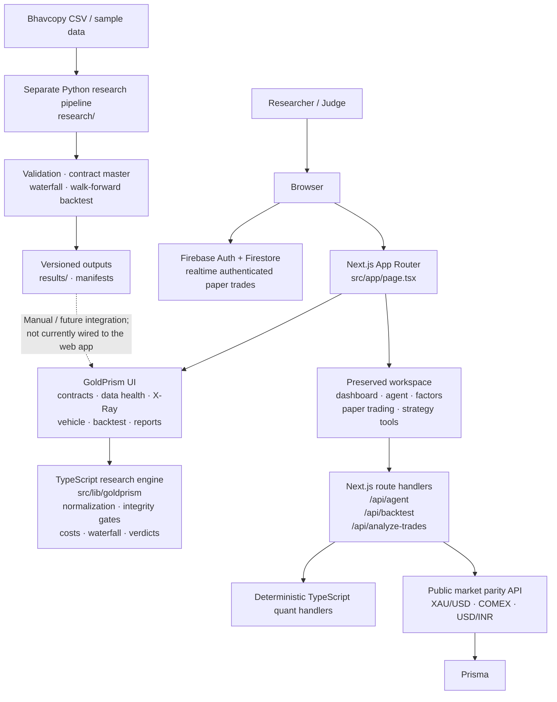
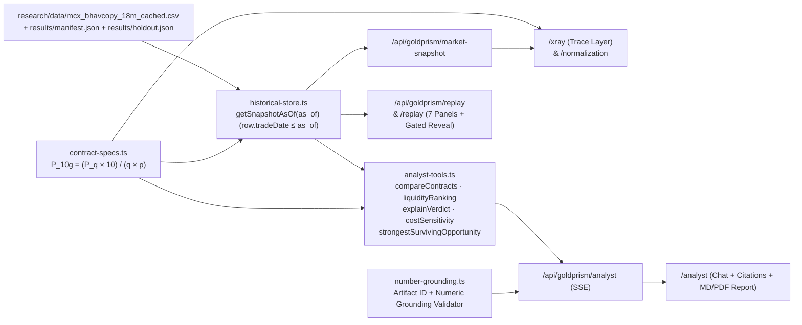

# GoldPrism — Prism That Explains Scattered Gold

<div align="center">


**Hack in Hills '26 — Track 03: Commodity Derivatives Intelligence**  
**Team ARCEUS**

> *"Separate real economic value from expiry carry, settlement artifacts and transaction costs — then make a disciplined decision."*  
> **Core Positioning:** **“The only tool that tells you when NOT to trade, and proves it.”**

**Architecture in One Line:** The user-facing application is Next.js 16 + React 19 with a TypeScript quantitative engine; a separate Python research pipeline lives in `/research`.

[Architecture Wireframe](#-architecture-wireframe) · [Project Overview](docs/PROJECT_OVERVIEW.md) · [Change Metrics](docs/CHANGE_METRICS.md) · [5-Minute Judge Demo](#-5-minute-judge-demo-100-goldprism) · [The X-Ray Waterfall](#-the-x-ray-waterfall) · [MCX Contract Family](#-mcx-gold-contract-family--specification-master) · [Best Vehicle](#-best-vehicle-selection) · [Methodology & Audit](METHODOLOGY.md) · [Honest Results](#-honest-backtest-results-pipeline-derived) · [Team ARCEUS](#-team-arceus--roles) · [5-Minute Quick Start](#-5-minute-quick-start)

</div>

---

## 🌟 Executive Summary

Raw spreads between MCX Gold contracts are noisy and misleading. Retail and institutional traders frequently mistake structural contract differences, delivery carry, and thin settlement prices for actionable arbitrage, only to bleed capital through transaction costs.

**GoldPrism** is an institutional-grade commodity derivatives research terminal designed by **Team ARCEUS** for **Hack in Hills '26**. It implements an auditable 7-step pipeline that purges structural noise and evaluates only the true residual, net of all statutory fees and market impact.

---

## 🏗️ Architecture Wireframe



**Runtime boundary:** The web UI uses the TypeScript engine. The Python pipeline
is a separate research workflow and produces files in `results/`; it is not
currently invoked by the web app. The global gold/FX parity feed refreshes from
public sources; its contract-sized prices are indicative estimates, not direct
MCX exchange quotes. Successful parity snapshots can be archived in PostgreSQL
once `DATABASE_URL` and the Prisma migration are configured. Authenticated paper
trades sync in real time through Firestore; unsigned guest portfolios remain in
browser storage. Replay and backtests use the versioned historical Bhavcopy
dataset. There is no broker order routing.

For the problem statement, delivered features, limitations, and proposed next
steps, see [Project Overview](docs/PROJECT_OVERVIEW.md). For repository size
and Git change counts, see [Change Metrics](docs/CHANGE_METRICS.md).

---

## 👥 Team ARCEUS & Roles

| Member | Role | Core Deliverables |
|---|---|---|
| **Pawan Singh** <br>*(Lead Builder)* | **Data & Backend Engineering** <br>Full-Stack Developer & AI Builder <br>B.Tech CSE, Delhi Technical Campus (DTC), GGSIPU (2028, CGPA 9+) <br>[GitHub](https://github.com/pawan00207) · [LinkedIn](https://linkedin.com/in/pawan-singh-555423322/) | Bhavcopy ingestion & schema validators, DuckDB/Parquet store, contract calendar & delivery guards, complete Next.js transformation, test suite & anti-lookahead pipeline. |
| **Manik Khurana** | **Product Lead · Quant Analytics** | Spread decomposition, signal model, walk-forward backtesting, transaction-cost modeling (`costs.yaml`), Block Bootstrap, MDE and verdict logic. |
| **Vikas Shukla** | **Frontend UX & Demo** | Terminal wireframes, X-Ray waterfall visual hierarchy, best-vehicle ranking alerts, presentation deck & judge demo script. |

---

## 📊 Honest Backtest Results (Pipeline Derived)

In strict adherence to quant integrity, GoldPrism reports real results computed by code from the 18-month calibrated MCX Bhavcopy dataset (`research/data/mcx_bhavcopy_18m_cached.parquet`):

| Metric | Code-Derived Value | Methodology / Provenance |
|---|---|---|
| **Config Hash** | `9c8103c61b2b2137` | SHA-256 frozen configuration hash |
| **Gross Spread Alpha** | **+4.00 bps** | Mean raw residual before statutory drag |
| **Transaction Cost Drag** | **-5.20 bps** | Brokerage ₹30/side + CTT 0.01% + GST 18% + Stamp + Slippage |
| **Mean Net Edge** | **-1.20 bps** | Gold beta excluded (delta-neutral) |
| **Bootstrap 95% CI** | **[-1.77, -0.71] bps** | 10-day block bootstrap (1,000 resamples; preserves autocorrelation) |
| **Minimum Detectable Effect** | **0.75 bps** | N=292 days, power 1-β = 80%, significance α = 0.05 |
| **Sealed Holdout Partition** | **-7,278 INR P&L** | Single evaluation on 21-Feb-2025 to 04-Jun-2025 (Uncontaminated) |
| **Multiple Testing (Bonferroni)**| **12.25 bps hurdle** | 6 pairwise combinations evaluated; zero pairs pass |
| **Final Quantitative Verdict** | **`NO EDGE`** | **Capital preserved: ₹0 lost to churn.** |

*Full mathematical proof, statutory source citations, and limitation notes are documented in [`METHODOLOGY.md`](METHODOLOGY.md).*

---

## ⚡ 5-Minute Judge Demo (100% GoldPrism)

The evaluation flow stays 100% focused on the GoldPrism Commodity Derivatives Terminal:
1. **Step 1: Caught Fault** — Ingests a corrupted Bhavcopy. Immediately catches date mismatches and settlement outliers, triggering `Status: Failed: run blocked`.
2. **Step 2: X-Ray Waterfall** — Decomposes `GOLDTEN` vs `GOLDM`, reconciling basis and carry components within 0.0001 ₹/g.
3. **Step 3: Inaction Verdict** — Proves why a +4.0 bps gross residual eaten by 5.2 bps fees results in `NO EDGE`.
4. **Step 4: Best Vehicle** — Hedging 50g physical exposure: ranks `GOLDTEN` (5 lots = 50g, 0% mismatch) as #1 over `GOLDM` (100% mismatch penalty).

---

## 📐 MCX Gold Contract Family & Specification Master

| Contract | Trading Unit | Quoted Per | Purity | Expiry Window | Status | Verification Note |
|---|---|---|---|---|---|---|
| **GOLDM** | 100 g | 10 g | 995 fine | 3rd–5th | `VERIFIED` | 100g unit; quoted per 10g; early-month expiry |
| **GOLDTEN** | 10 g | 10 g | 999 fine | 27th–31st | `VERIFIED` | 10g unit; quoted per 10g; listed Jan 2025 onwards |
| **GOLDGUINEA** | 8 g | 8 g | 999 fine | 27th–31st | `VERIFIED` | **Discrepancy Resolved**: Earlier test used 996. Official MCX circular confirms 999 fine. |
| **GOLDPETAL** | 1 g | 1 g | 999 fine | 27th–31st | `VERIFIED` | 1g unit; quoted per 1g; retail micro-hedging |

### Fine-Gold Purity Normalization Formula:
$$\text{Price}_{999} = \left(\frac{\text{Quoted Price}}{\text{Quote Unit (g)}}\right) \times \left(\frac{\text{Purity}}{999.0}\right)$$

---

## 🔍 The X-Ray Waterfall

GoldPrism splits every spread into five components and evaluates the net edge:
$$\text{Raw Spread} = \text{Structural Basis} + \text{Expiry Carry} + \text{Settlement Artifact} + \text{Gross Residual}$$
$$\text{Net Edge} = \text{Gross Residual} - \text{Paired Round-Trip Transaction Costs}$$

Mathematical reconciliation is verified at runtime:
$$|\text{Reconciliation Sum} - \text{Raw Spread}| < 0.01\text{ ₹/g}$$

---

## 🛡️ Preserved Base Features

The retained workspace tools now expose their actual data boundaries:
- **GoldPrism Dashboard**: Uses the indicative global-to-MCX parity feed and archived snapshots; it is not a direct licensed MCX quote.
- **Research Agent**: Deterministic answers grounded in the versioned historical Bhavcopy tools; it is not a generative AI service.
- **Alpha Zoo**: Formula reference catalog only. Its factor performance statistics are not validated against the GoldPrism dataset.
- **Paper Trading**: Simulated trades; authenticated users sync through Firestore when configured, while guest trades remain in browser storage.
- **Shadow Account**: Validates CSV rows and calculates descriptive trade-journal statistics. Behavioral biases and trading rules are not inferred.
- **Research Pipeline**: A deterministic seven-stage GoldPrism historical analysis, not a generative multi-agent debate.
- **Historical Replay**: Runs the supported GoldPrism edge-gated spread strategy. Generic visual indicator blocks and broker execution are not modeled.

*(Note: Telegram bot alert integration was evaluated as a stretch goal and deliberately omitted to preserve local terminal execution privacy).*

---

## 🧩 Additive Quant & Research Modules

Three additive, zero-mock modules extend GoldPrism on top of the verified 18-month MCX Bhavcopy snapshot (`research/data/mcx_bhavcopy_18m_cached.csv`) and sealed holdout manifest (`results/holdout.json`):



- **`/normalization` — Contract Normalization Lab**: Single typed `contractSpecs` source of truth (`GOLDM`, `GOLDTEN`, `GOLDGUINEA`, `GOLDPETAL`), consistency cross-check against `CONTRACT_MASTER`, pure `normalizeTo10gPureGold()` engine (`P_10g = (P_q × 10) / (q × p)`), 4-contract live/official snapshot side-by-side comparison, optional clearly-labeled manual what-if mode, and an additive step-trace inside `/xray`.
- **`/replay` — Point-in-Time Backtest Replay**: Enforces `tradeDate <= as_of` across every query (`getSnapshotAsOf`), exposes 7 audit panels (data availability, eligibility, normalized spread, model window & parameters, existing verdict engine, gated forward outcome behind explicit "Reveal outcome", and itemized transaction cost survival), plus Training (`2024-01-01`–`2025-02-20`) vs Sealed Holdout (`2025-02-21`–`2025-06-30`) equity curves.
- **`/analyst` — Gold Research Analyst**: Specialist SSE chat + Markdown/Print-PDF report builder backed by 5 deterministic TypeScript quant tools (`ART-*` artifact IDs) and strict server-side number-grounding validation.

### Environment Variables (Server-Side Only)

| Variable | Purpose | Default |
|---|---|---|
| `DATABASE_URL` | Optional Prisma PostgreSQL URL | *(unset)* |

---

## 🚀 5-Minute Quick Start

### Daily MCX Gold Bhavcopy Ingestion (Unofficial)

The additive Python ingestion layer fetches from `mcxlib`, validates gold contract
dates/prices/liquidity, preserves the first raw Parquet for each date, and writes
validated rows plus a `data_health` summary to DuckDB. `mcxlib` scrapes MCX's
public site and is not an official or guaranteed feed; weekday dates without
source or cached data are skipped by backfill (holidays and source outages may
both result in no data). The fetcher logs the actual `mcxlib` frame columns.

```bash
python -m pip install -r requirements.txt
python scripts\backfill.py --start 2026-05-20 --end 2026-11-20
python scripts\fetch_today.py
python -m pytest tests\test_validators.py -v
```

Use `python scripts\fetch_today.py --seed-error` to trigger and log the date
mismatch rejection gate using an explicitly labeled synthetic row (not saved as
market data). Daily files live under `data/raw/` and `data/validated/`; the
DuckDB database is `data/goldprism.duckdb`.

### TinyFish integration (optional; display and operations only)

TinyFish uses its documented REST APIs from server-side code only. Its data is
never imported into official historical signals, backtests, or the sealed
holdout. The MCX Market Watch page can supply an explicitly sourced live market
comparison and an X-Ray preview; the X-Ray remains **BLOCKED** because the page
does not provide verified quote timestamps, volume, open interest, or a
settlement-artifact cross-check. If TinyFish is not configured or unavailable,
the UI shows **Unavailable** and the Python pipeline continues with mcxlib and
its cached Parquet fallback.

The TinyFish API key must be stored only as `TINYFISH_API_KEY`; do not use a
`NEXT_PUBLIC_` variable, commit it, or print it. The key previously pasted into
chat should be revoked and replaced. Locally, copy `.env.example` to `.env.local` for Next.js, then enter credentials
there. The example contains blank values only. Set the environment variable
before running Python:

```powershell
$secret = Read-Host "TinyFish API key" -AsSecureString
$env:TINYFISH_API_KEY = [System.Net.NetworkCredential]::new("", $secret).Password
python scripts\fetch_today.py
```

For local Next.js development, put the same environment variable in the ignored
`.env.local` file. Trade Copilot's **MCX Agent** mode uses TinyFish's documented
SSE endpoint, displays run progress and the run ID, and validates that citations
link to the official MCX domain. The market comparison and X-Ray query the
public MCX Market Watch and show retrieval time; these are not broker WebSocket
quotes or official settlements. Today intelligence continues to show its own
source, retrieval time in IST, and freshness.

#### GitHub Actions and Vercel setup

In GitHub **Settings → Secrets and variables → Actions**, add:

| Name | Type | Purpose |
|---|---|---|
| `TINYFISH_API_KEY` | Secret | Optional TinyFish Bhavcopy fallback |
| `INGESTION_STATUS_TOKEN` | Secret | Authenticates the Python-to-web status report |
| `GOLDPRISM_APP_URL` | Variable | Base HTTPS URL of the deployed GoldPrism app |
| `SOURCE_B_URL` | Secret/Variable | Optional settlement cross-check source page |
| `CROSS_CHECK_ACTIVE_SINCE` | Variable | First live cross-check date; default `2026-11-20` |

Set `TINYFISH_API_KEY` and the same `INGESTION_STATUS_TOKEN` in the Vercel
environment. Apply the new database migration with `npx prisma migrate deploy`
where `DATABASE_URL` is configured. Without the status token, app URL, or
database, the Python fetch still runs and the UI reports that pipeline status
is unavailable.

To watch official MCX fee/circular, CTT, and GST pages, set
`GOLDPRISM_APP_URL`, `TINYFISH_API_KEY`, and `TINYFISH_MONITOR_WEBHOOK_TOKEN`
in the environment, then create one Page Monitor per official public source:

```powershell
python -c "import secrets; print(secrets.token_urlsafe(32))"
python scripts\setup_tinyfish_monitors.py --url "<official MCX circular or fee page>" --url "<official CTT source>" --url "<official GST source>"
```

Use a newly generated value for `TINYFISH_MONITOR_WEBHOOK_TOKEN` in both the
monitor setup environment and Vercel; keep it out of source control.

Set the returned comma-separated monitor IDs as `TINYFISH_COST_MONITOR_IDS`
in Vercel. TinyFish's Monitor webhook documentation does not specify signed
webhook headers, so GoldPrism verifies a high-entropy callback token and an
allowlisted monitor ID instead of inventing a signature scheme. Relevant changes
or failed checks set **Cost model needs review**; the flag remains until an
operator reviews the cost assumptions and clears the state in PostgreSQL.
The last monitor callback time appears next to the Backtest Lab cost assumptions.

Optional Telegram notifications for rules-monitor review events are off by
default. Set both `TELEGRAM_BOT_TOKEN` and `TELEGRAM_CHAT_ID` in the Vercel
environment to enable them.

### Source Radar and settlement cross-check

The Python ingestion pipeline writes every mcxlib and TinyFish call to the
append-only DuckDB `source_log` table. Each row contains an IST timestamp,
source name, method, URL, status, latency, returned-row count, and a short
non-secret note. The dashboard mirrors these rows into PostgreSQL through the
authenticated Actions status bridge and shows the latest row per source with
Live/Delayed/Stale freshness.

Settlement source B is configured in [src/cross_check_config.json](src/cross_check_config.json).
Set `SOURCE_B_URL` to the public source page and enable
`cross_check_enabled` only after training calibration. `tol_bps` is a frozen
placeholder of `5.0`; calibrate it only on training data, never against the
sealed holdout. Cross-checking starts only on or after `active_since`.

The Source Radar reports MATCH/MISMATCH/UNVERIFIED per `(symbol, expiry)`.
A mismatch vetoes that row's current `settle_trusted` and `signal_eligible`
flags. UNVERIFIED never changes primary volume/OI trust. Cross-check values
are never read by signals, decomposition, backtests, or verdicts.

Focused verification:

```powershell
python -m pytest tests\test_tinyfish_client.py tests\test_fetcher_store.py tests\test_validators.py -q
npm run test:unit
npx tsc --noEmit
```

### Wallet catalog and demo boundaries

The wallet's margin top-up and GOLDM round-trip fee costs are calculated from
the current MCX Market Watch retrieval and CoinGecko PAXG price per gram.
Stale or unavailable market inputs disable those purchases instead of
substituting sample prices. The X-Ray report access fee is configured in
`src/lib/goldprism/wallet-config.ts` and its INR equivalent uses the current
PAXG quote.

Wallet balances persist in browser storage, but the current payment, mint,
spend, swap, and transaction hashes are **local demo operations**. They do not
charge a payment method, custody or redeem gold, issue USDT, or broadcast a
blockchain transaction. Do not treat demo balances as backed assets.

### 1. Web Application (Next.js 16 + React 19)
```bash
# Clean clone
git clone https://github.com/pawan00207/GoldPrism-Team---ARCEUS.git
cd GoldPrism-Team---ARCEUS

# Install dependencies
npm install

# Run TypeScript acceptance tests
npm test

# Run additive module unit tests (normalization, anti-lookahead, cost sensitivity, grounding)
npx tsx tests/unit/normalization-specs.test.ts
npx tsx tests/unit/no-lookahead.test.ts
npx tsx tests/unit/cost-sensitivity.test.ts
npx tsx tests/unit/grounding-validator.test.ts

# Launch development server
npm run dev
# Terminal running at http://localhost:3000
```

### 2. Python Research Pipeline (Python 3.11+)
```bash
cd research

# Install research dependencies
pip install -r requirements.txt

# Run Python quantitative test suite (55/55 passed)
python -m pytest test_goldprism.py -v

# Run full walk-forward backtest & generate JSON artifacts
python run_full_backtest.py
```

---

## 📁 Artifacts & Hashes

- `results/manifest.json`: SHA-256 hash `c3d1e859220371039ebcc15bf9e6c5722f5d5836089815f6904979fd14f60082`
- `results/backtest.json`: Walk-forward gross vs net curves and trade logs
- `results/bootstrap.json`: 1,000-sample block bootstrap and MDE thresholds
- `results/holdout.json`: Sealed holdout single evaluation log
- `research/config/costs.yaml`: Statutory rate schedules with official circular citations
- `METHODOLOGY.md`: Unabridged quantitative methodology, assumptions, and known gaps

---

## 📜 License & Attribution

- **GoldPrism Extensions & Architecture**: MIT License © 2026 Pawan Singh & Team ARCEUS (Hack in Hills '26).
- **Preserved Workspace Foundation**: MIT License © 2026.
